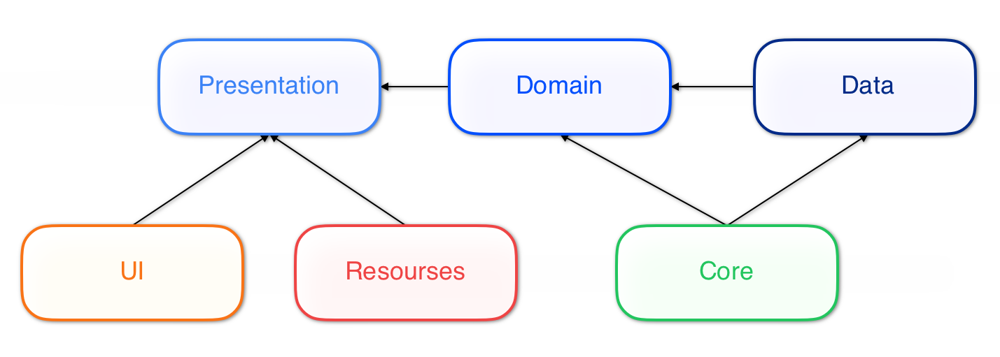

# TuistApp — Modular iOS Architecture with Tuist DSL

Demo project for the article about a type-safe modular architecture for iOS built on top of Tuist and Swift Package Manager.

The repository shows how `Project.swift` and `ProjectDescriptionHelpers` can be used as a small architecture DSL instead of a flat list of string-based targets and dependencies.

## What is in the repo

- `Project.swift`
  - declares shared modules, services, and features via the `@ArchitectureBuilder` DSL
  - defines the application target (`App`) and generates the project graph
- `Tuist/ProjectDescriptionHelpers/Architecture`
  - defines the type-safe architecture DSL (`Architecture`, `Module`, `Feature`, `Service`, `AppTarget`)
  - validates the dependency graph at manifest evaluation time (`ArchitectureValidator`, `CycleDetector`)
  - enforces direct-import boundaries at build time (`ImportGuard`)
  - generates production and unit test targets with helper factories (`TargetFactory`)
- `Tuist/Package.swift`
  - declares external Swift Package Manager dependencies and maps product types from `RemotePackage`
- `App.xcworkspace` / `App.xcodeproj`
  - iOS application workspace and project generated by Tuist
- `Sources` & `Tests`
  - application target under `Sources/App`
  - shared modules: `Core`, `UI`, `DI`, `Resources`, `Networking`
  - feature and service modules under `Sources/Features`
  - unit test targets under `Tests`

## Architecture shape

The project currently demonstrates two target-generation patterns.



*High-level dependency structure generated by `Project.swift`.*

### 1. Classic feature layering

For regular features we generate:

- `Feature_Presentation`
- `Feature_Domain`
- `Feature_Data`

This is used for:

- `MainScreen`
- `DetailScreen`

Dependency flow:

```text
Presentation -> Domain -> Data
Presentation -> Core, UI, Resources
Domain       -> Core
Data         -> Core, Networking
```

### 2. API / Implementation split

For infrastructure-style services we generate:

- `Service_Api`
- `Service_Impl`

This is used for:

- `Router`

Dependency flow:

```text
Impl -> Api
Impl -> Core
```

## Current demo modules

Shared modules:

- `Core` mock module
- `UI`
- `DI` mock module
- `Resources`
- `Networking`

Generated feature and service modules:

- `Router_Api`
- `Router_Impl`
- `MainScreen_Presentation`
- `MainScreen_Domain`
- `MainScreen_Data`
- `DetailScreen_Presentation`
- `DetailScreen_Domain`
- `DetailScreen_Data`

## Project highlights

- Module names and dependencies are expressed as Swift types (`LocalModule`, `FeatureID`, `ServiceID`, `RemotePackage`), not loose strings.
- Architectural rules are enforced by construction (`ModuleDependency` vs `CompositionDependency`), at generation time (`ArchitectureValidator` + `CycleDetector`), and at build time (`ImportGuard`).
- Feature and service targets (along with their unit test targets) are generated from reusable layer rules.
- Shared resources are packaged through Tuist resource bundles (`Resources.xcassets`).
- Networking is isolated behind a dedicated module using `Alamofire`.
- Router composition is split into public API and implementation targets.

## Run the demo

Open the generated workspace directly:

```bash
open App.xcworkspace
```

Or resolve dependencies and regenerate the project with Tuist:

```bash
tuist install
tuist generate
```

## Important notes

- The project depends on `Alamofire`, so the first dependency resolution (`tuist install`) requires network access.
- The repository is meant to demonstrate modular project structure and dependency rules first.
- Some parts of the demo are intentionally lightweight and optimized for explaining the architecture, not for production completeness.

## Folder map

```text
TuistApp
├── README.md
├── Project.swift
├── Tuist.swift
├── App.xcworkspace
├── App.xcodeproj
├── docs
│   └── architecture.png
├── Tuist
│   ├── Package.swift
│   └── ProjectDescriptionHelpers
│       └── Architecture
├── Sources
│   ├── App
│   ├── Core
│   ├── DI
│   ├── Networking
│   ├── Resources
│   ├── UI
│   └── Features
│       ├── Router
│       ├── MainScreen
│       └── DetailScreen
└── Tests
    ├── CoreTests
    ├── DITests
    ├── NetworkingTests
    ├── ResourcesTests
    ├── UITests
    └── Features
        ├── MainScreen
        └── DetailScreen
```

## Purpose

This project is a compact, readable companion to the article. The main goal is to show how architectural rules can live directly in `Project.swift` and `ProjectDescriptionHelpers` and stay maintainable as the number of modules grows.
